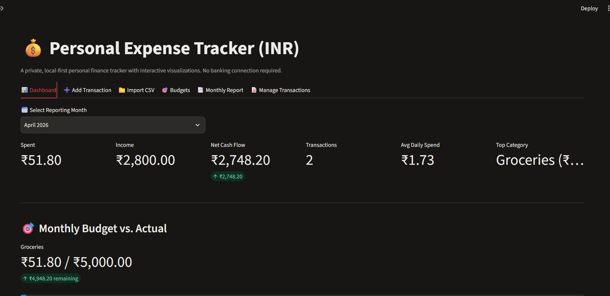
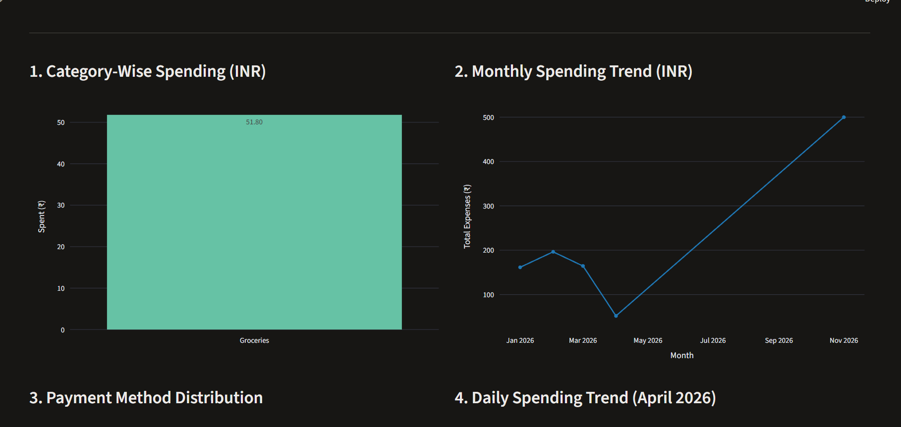
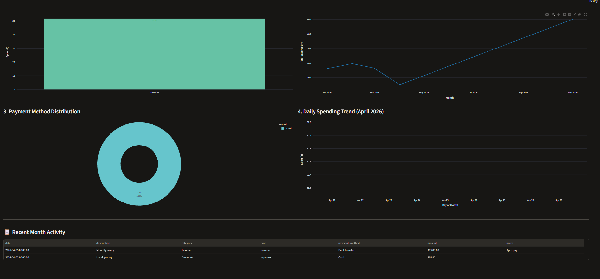
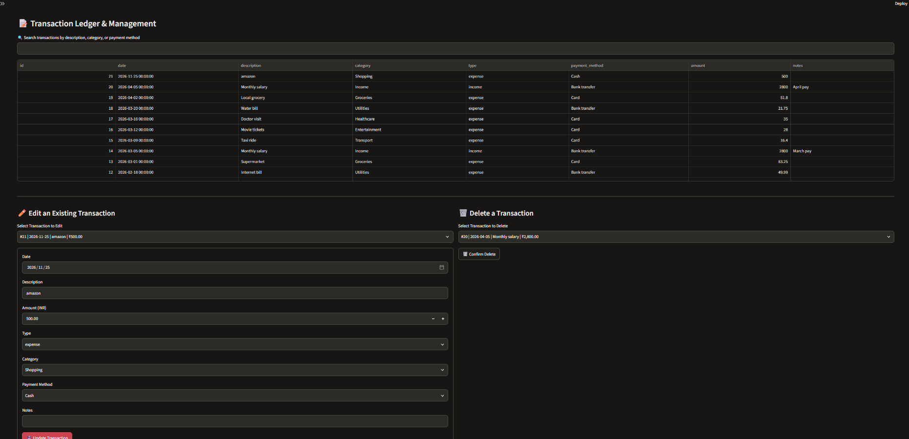
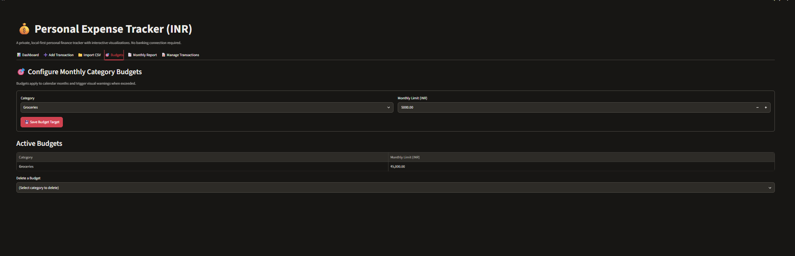
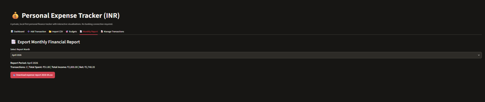
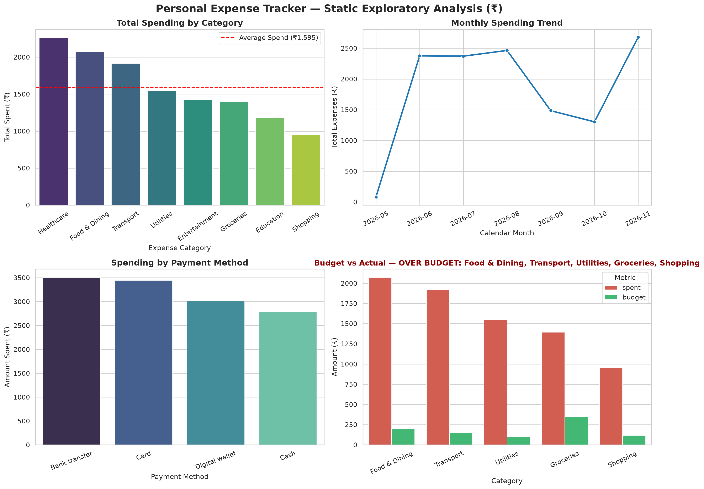

# Personal Expense Tracker with Data Visualization

A local-first, privacy-focused financial tracking and analytical platform built with Python, Streamlit, Pandas, NumPy, Plotly, and SQLite.

---

## 1. Project Overview

Personal Expense Tracker with Data Visualization is an open-source, local-first web application designed to help individuals record, categorize, analyze, and visualize personal financial cash flows without requiring external banking connections or third-party credential integrations.

The application addresses financial privacy concerns by operating entirely within the user local environment. Data persistence is handled via a local SQLite database, transaction imports are validated against schema constraints, and duplicate entries are eliminated through compound SHA-256 cryptographic fingerprinting.

---

## 2. Key Capabilities

- Full Transaction Lifecycle Management: Add, view, search, edit, and delete income and expense records with persistent SQLite storage.
- Explainable Heuristic Categorization: Offline rule-based keyword mapping in `src/expense_tracker/categorization.py` suggests categories without external network calls or cloud dependencies. Users retain full control to override suggestions.
- Schema Validation and CSV Ingestion: Upload bank statements with row-level validation. The ingestion pipeline filters corrupt dates, empty descriptions, and non-positive amounts while generating descriptive rejection logs for non-conforming rows.
- Idempotent Deduplication: Generates SHA-256 compound hashes from CSV transaction attributes to prevent duplicate imports during statement re-uploads, while preserving legitimate identical manual entries.
- Deterministic Synthetic Data Generator: Includes a reproducible, seed-controlled synthetic transaction generator to simulate multi-month cash flows for evaluation.
- Budget Tracking and Overspending Alerts: Set category-specific monthly spending limits with progress indicators and automatic visual overspending alerts.
- Interactive Analytical Visualizations: Four dynamic Plotly charts covering category-wise distribution, multi-month expenditure trends, payment method mix, and daily spending timelines.
- Static Exploratory Analysis: Companion script and Jupyter notebook generating publication-quality static figures using Matplotlib and Seaborn.
- Audit-Ready CSV Report Generation: Export structured monthly statements containing metadata, KPI summaries, category budget comparisons, payment breakdowns, and itemized records.
- Configurable Display Currency: Defaults to INR (Rs. / INR) with options for USD, EUR, GBP, and JPY. The system formats values according to the chosen currency and assumes uniform currency usage per dataset.

---

## 3. Application Screenshots and Visualizations

The platform features an interactive dashboard rendered with Streamlit and Plotly, as well as static publication figures generated with Seaborn and Matplotlib.

### 3.1 Dashboard Overview and Monthly Budget Tracking

The main dashboard provides high-level financial KPI cards (Total Spent, Total Income, Net Cash Flow, Transaction Count, Average Daily Spend, and Highest Spending Category) alongside monthly budget progress bars and overspending alerts.



### 3.2 Interactive Analytics and Trend Visualizations

Interactive Plotly charts display category-wise expenditure breakdowns and historical multi-month spending trends.



Payment method distribution donut charts and calendar-bounded daily spending timelines provide granular insights into payment preferences and daily burn rates.



### 3.3 Transaction Management and Editing

Users can search, inspect, update, and delete transactions. The editing interface preserves existing payment methods and categories when modifying other transaction attributes.



### 3.4 Category Budget Configuration

Category spending targets can be configured and updated dynamically. When actual expenditures exceed the allocated limit, real-time warning indicators flag the overspending category.



### 3.5 Monthly Statement Report Export

A dedicated reporting engine compiles summary metrics, category totals, payment breakdowns, and itemized records into a downloadable CSV statement.



### 3.6 Static Exploratory Data Analysis

A four-panel exploratory figure generated using Seaborn and Matplotlib for offline coursework and report inclusion.



---

## 4. System Architecture

The project employs a layered multi-tier architecture with clean separation between the presentation layer, domain logic, data access abstractions, and persistent storage.

```text
+-------------------------------------------------------------+
|                     PRESENTATION LAYER                      |
|       Streamlit Dashboard (main.py) + Plotly Visuals        |
+------------------------------+------------------------------+
                               |
                               v
+-------------------------------------------------------------+
|                     DOMAIN LOGIC LAYER                      |
|   Analytics Engine       Categorizer        Report Builder  |
|   (analytics.py)    (categorization.py)     (reports.py)    |
+------------------------------+------------------------------+
                               |
                               v
+-------------------------------------------------------------+
|                    DATA ACCESS & STORAGE                    |
|    Database Layer: Connection Context Manager & CRUD        |
|          SQLite Storage: transactions, budgets              |
+-------------------------------------------------------------+
```

### Data Pipeline Stages

1. Ingestion: Form submission, CSV file upload, or synthetic generator invocation.
2. Validation and Sanitization: ISO-8601 date checking, numeric parsing, whitespace trimming, and transaction type verification.
3. Categorization: Keyword token extraction against predefined domain rules.
4. Deduplication: Compound hash calculation and SQLite unique constraint checking.
5. Persistence: Transactional insert or update operations in SQLite.
6. Aggregation and Metrics: Vectorized grouping and statistical summarization using Pandas and NumPy.
7. Presentation and Export: Real-time interactive Plotly dashboard rendering and multi-section CSV report generation.

---

## 5. Repository Structure

```text
Personal-Expense-Tracker-Visualization/
|-- data/
|   |-- sample_transactions.csv        # Bundled sample transaction dataset
|   `-- expenses.db                    # Local SQLite database (Git-ignored)
|-- docs/                              # Project documentation
|   |-- ARCHITECTURE.md                # System topology and component design
|   |-- IMPLEMENTATION_PLAN.md         # Phased implementation reference
|   |-- INSTALLATION.md                # Environment setup instructions
|   |-- INTERVIEW_PREP.md              # Technical questions and architectural review
|   |-- PROJECT_GUIDE.md               # User operational guide
|   `-- SIMULATION_AND_RUN.md          # Virtual execution walkthrough
|-- images/
|   |-- .gitkeep                       # Keeps images folder tracked in Git
|   `-- exploratory_spending_analysis.png # Static exploratory figure
|-- notebooks/
|   |-- exploratory_analysis.py        # Static figure generation script
|   `-- exploratory_analysis.ipynb     # Interactive Jupyter analysis notebook
|-- outputs/                           # Runtime output directory (Git-ignored)
|   `-- .gitkeep
|-- project_execution_docs/            # Dedicated technical documentation suite
|   |-- README.md                      # Documentation index
|   |-- 01_ARCHITECTURE.md             # Multi-tier architectural specifications
|   |-- 02_DATA_FLOW.md                # Ingestion and analytics data pipelines
|   |-- 03_MODULE_BREAKDOWN.md         # Functional specifications per module
|   |-- 04_DATASET_AND_SCHEMAS.md      # Data schemas and synthetic parameters
|   |-- 05_MODEL_AND_LEARNING_LOGIC.md # Keyword heuristics and learning loop
|   |-- 06_EXECUTION_AND_VALIDATION_LOG.md # Implementation and verification audit
|   `-- TECHNICAL_MANAGER_REVIEW_REPORT.md # Technical review document
|-- reports/
|   |-- .gitkeep
|   `-- examples/
|       `-- expense-report-2026-01.csv # Sample exported monthly report
|-- src/
|   `-- expense_tracker/
|       |-- __init__.py                # Package root
|       |-- analytics.py               # Statistical and aggregation functions
|       |-- categorization.py          # Offline heuristic categorizer
|       |-- database.py                # SQLite persistence and deduplication
|       |-- reports.py                 # Monthly CSV report builder
|       `-- synthetic.py               # Deterministic synthetic data generator
|-- tests/                             # Automated test suite (20 tests in 4 files)
|   |-- test_analytics.py              # Cleaning, tie-break, and KPI tests
|   |-- test_categorization.py         # Keyword matching and fallback tests
|   |-- test_database.py               # Persistence, CRUD, and deduplication tests
|   `-- test_reports.py                # CSV export and synthetic generator tests
|-- .env.example                       # Environment configuration template
|-- .gitignore                         # Git exclusion rules
|-- main.py                            # Streamlit entry point
|-- pytest.ini                         # Pytest configuration
`-- requirements.txt                   # Project dependencies
```

---

## 6. Installation and Setup

### Prerequisites

- Python 3.10, 3.11, or 3.12
- Git

### 1. Windows (PowerShell)

```powershell
# Clone the repository
git clone https://github.com/YOUR-USERNAME/personal-expense-tracker.git
cd "Personal-Expense-Tracker-Visualization"

# Create and activate a virtual environment
python -m venv .venv
.\.venv\Scripts\Activate.ps1

# Install dependencies
pip install -r requirements.txt

# Run the automated test suite
pytest -v

# Launch the Streamlit dashboard
streamlit run main.py
```

### 2. macOS and Linux (Bash or Zsh)

```bash
# Clone the repository
git clone https://github.com/YOUR-USERNAME/personal-expense-tracker.git
cd "Personal-Expense-Tracker-Visualization"

# Create and activate a virtual environment
python3 -m venv .venv
source .venv/bin/activate

# Install dependencies
pip install -r requirements.txt

# Run the automated test suite
pytest -v

# Launch the Streamlit dashboard
streamlit run main.py
```

The application will be accessible in your web browser at `http://localhost:8501`.

---

## 7. CSV Schema Specification

Uploaded CSV files must contain the following required column headers:

| Field Name | Type | Required | Description / Accepted Values |
| :--- | :--- | :--- | :--- |
| `date` | String | Yes | ISO-8601 date format (YYYY-MM-DD preferred). |
| `description` | String | Yes | Merchant or transaction description. |
| `amount` | Float | Yes | Positive numeric transaction amount. |
| `category` | String | No | Category label. Inferred automatically if left blank. |
| `type` | String | No | Transaction classification: `expense` or `income` (defaults to `expense`). |
| `payment_method` | String | No | Payment channel: `UPI / Digital Wallet`, `Card`, `Cash`, `Bank Transfer`, or `Other`. |
| `notes` | String | No | Optional user remarks or metadata. |

---

## 8. Verification and Quality Assurance

The analytical and database components are verified through an automated Pytest test suite covering 20 test cases across four test modules:

```bash
pytest -v
```

### Test Coverage Summary

- `tests/test_analytics.py`: Data cleaning, required column enforcement, tie-breaking behavior, calendar-day spend calculation, budget status calculation, and empty dataset handling.
- `tests/test_categorization.py`: Income identification, keyword rule matching, fallback mapping, and whitespace/case insensitivity.
- `tests/test_database.py`: Transaction insertion, update operations (verifying payment method preservation), record deletion, SHA-256 deduplication, and budget CRUD.
- `tests/test_reports.py`: CSV report structure validation, month label formatting, synthetic generator determinism, and transaction distribution checks.

---

## 9. Security and Privacy Considerations

- Local Storage Only: All transactions and budgets reside exclusively in a local SQLite database (`data/expenses.db`).
- Zero Network Telemetry: No financial data, account numbers, or merchant descriptions are transmitted over external networks.
- No Hardcoded Secrets: The application contains zero hardcoded API keys, tokens, or credentials. Custom database paths can be specified through the `EXPENSE_TRACKER_DB` environment variable via `.env`.
- Credential Safety: Sensitive files (`.env`, `data/*.db`, `.streamlit/secrets.toml`) are excluded from version control via `.gitignore`.

---

## 10. Limitations and Future Work

- Single-Currency Assumption: The application displays values using the configured display currency and assumes that all records within a dataset share that currency. Cross-currency exchange rate conversions are intentionally omitted.
- Heuristic Inference: Category suggestions rely on keyword pattern matching and should be reviewed during statement import. Future enhancements include an offline Naive Bayes classifier trained on historical user edits.
- Multi-User Concurrency: SQLite is optimized for single-user local access. Deploying to multi-tenant cloud environments would require migrating to PostgreSQL with a connection pool.
